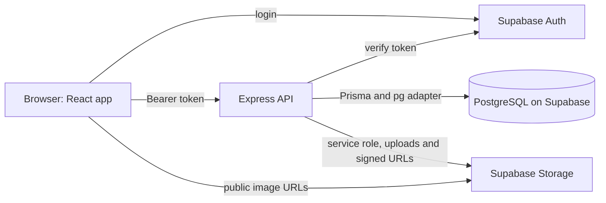
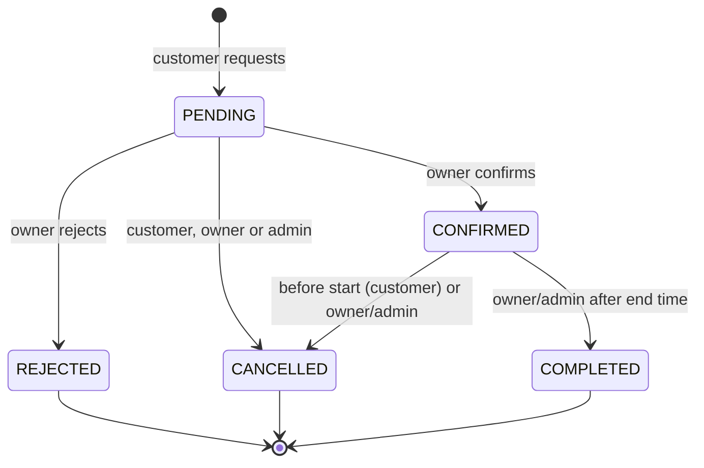
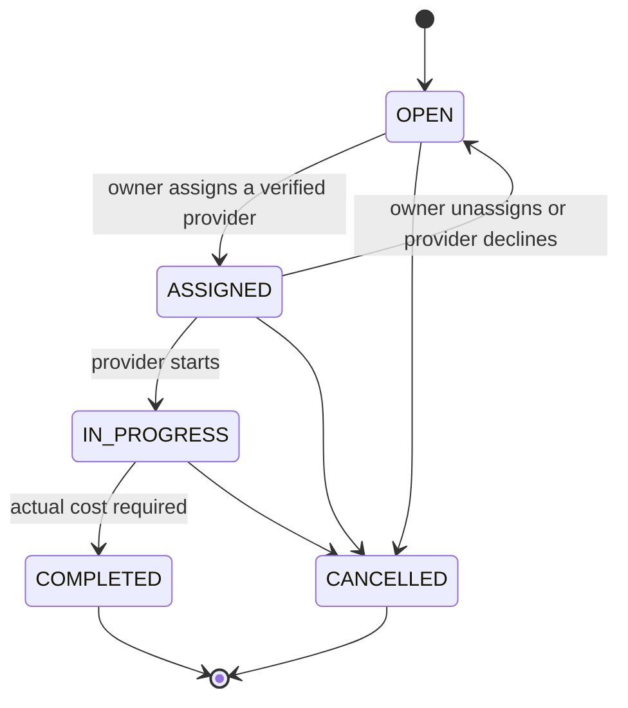

# Nexora

Nexora is a full-stack property management and space booking platform. Owners list properties and rentable spaces, customers search and book them, service providers receive maintenance jobs, and an admin oversees the platform.

The project covers the whole lifecycle of a rented space: listing, search, booking with conflict-free scheduling, payment and refunds, reviews, inspections with a health score, maintenance work orders, expense tracking, and an owner dashboard whose totals reconcile with the underlying bookings, payments and expenses.

> **Project status:** feature complete for the core scope. Payments are simulated, and two items are intentionally not included (see [Known limitations](#known-limitations)).

---

## Table of contents

1. [Features](#features)
2. [Tech stack](#tech-stack)
3. [Architecture](#architecture)
4. [Repository structure](#repository-structure)
5. [Getting started](#getting-started)
6. [Environment variables](#environment-variables)
7. [Supabase setup](#supabase-setup)
8. [Database notes](#database-notes)
9. [Running the project](#running-the-project)
10. [Demo walkthrough](#demo-walkthrough)
11. [Business rules](#business-rules)
12. [API overview](#api-overview)
13. [Security](#security)
14. [Frontend design system](#frontend-design-system)
15. [Testing and quality checks](#testing-and-quality-checks)
16. [Scripts reference](#scripts-reference)
17. [Deployment](#deployment)
18. [Known limitations](#known-limitations)
19. [Troubleshooting](#troubleshooting)
20. [Credits and license](#credits-and-license)

---

## Features

### Roles

| Role | What they can do |
|---|---|
| **Guest** | Browse and filter available spaces, view listing details, photos, availability and reviews |
| **Customer** | Request bookings, see a live price quote, pay, cancel with a refund policy, leave reviews, save favorites, receive notifications |
| **Owner** | List properties and spaces with photos, confirm or reject booking requests, run inspections, create maintenance requests and assign providers, record expenses with receipts, view an income and expense dashboard |
| **Service provider** | Create a business profile, receive assigned maintenance jobs, post progress updates with photos, complete jobs with an actual cost |
| **Admin** | Manage users, verify service providers, manage service categories, view platform statistics |

### Marketplace and booking

- Public landing page with real listings that load as you scroll, with city, type and text filters
- Explore page with URL-synced filters (price range, capacity, sort, space type)
- Listing page with a photo gallery and lightbox, availability calendar and reviews
- Live price quote from the server (subtotal, tax, total) before booking
- No double booking: a database row lock and an overlap check run inside one transaction
- Booking lifecycle: `PENDING`, `CONFIRMED`, `COMPLETED`, with `CANCELLED` and `REJECTED` branches, and a history row for every change
- Simulated payments with partial payments, an overpayment guard and automatic refunds
- Reviews that can only be left after a completed booking, one per booking
- In-app notifications with unread count

### Property care

- Inspections with a built-in 21 item checklist template, condition ratings and photo evidence in a private bucket
- Server-side health score (weighted by item condition) with a per-category breakdown and trend
- Maintenance work orders with a strict workflow: assign, start, complete, cancel, decline
- Provider verification and category matching before assignment
- Expenses with categories, private receipts (image or PDF) and monthly summaries
- One-click "record expense from a completed job", enforced as one expense per job
- Owner dashboard with income received, expected income, expenses, net, occupancy, maintenance counts and upcoming items

### Engineering

- Server-side pricing with `Decimal` arithmetic only, never floats
- Concurrency tests and smoke tests for booking, assignment and expense recording
- Row Level Security enabled on every table
- Real file type detection by magic bytes for all uploads
- Role and ownership checks on every resource, with `404` for resources a user should not know exist
- Design lint that fails the build on banned UI patterns

---

## Tech stack

| Layer | Technology |
|---|---|
| Backend | Node.js, Express 4, JavaScript (ES modules) |
| Validation | Zod |
| ORM | Prisma 7 with the `pg` driver adapter |
| Database | PostgreSQL on Supabase |
| Authentication | Supabase Auth (passwords are never stored by Nexora) |
| File storage | Supabase Storage (6 buckets) |
| Logging | pino and pino-http |
| Security middleware | helmet, cors, express-rate-limit |
| Backend tests | Vitest and Supertest |
| Frontend | React, Vite, JavaScript (JSX) |
| Styling | Tailwind CSS |
| Data fetching | TanStack Query |
| Routing | React Router |
| Forms | React Hook Form and Zod |
| Animation | Framer Motion |
| Charts | Recharts |
| Icons | Lucide |
| Fonts | Bodoni Moda (display) and Inter (body) |
| Frontend tests | Vitest and Testing Library |
| Planned hosting | Frontend on Vercel, backend on Render or Railway |

---

## Architecture



Key points:

1. **Login happens in the browser** directly with Supabase. The browser then sends the access token to the Express API.
2. **The API verifies the token** with Supabase and loads the user's profile from the `profiles` table. **Roles are read only from that table**, never from the token or user metadata.
3. **All writes go through the API.** The API connects to the database as a privileged role, so it enforces security in code (role checks, ownership checks, validation). Row Level Security is a second layer for anyone calling Supabase directly.
4. **All uploads go through the API**, which validates type, size and ownership. Public buckets serve listing photos. Private buckets (inspections, maintenance, receipts) are only served through short-lived signed URLs.
5. **Prisma manages only the `public` schema.** Supabase's own `auth` and `storage` schemas are never touched by migrations.

### Booking status flow



### Maintenance job flow



---

## Repository structure

```
.
|-- PROJECT_RULES.md          Permanent engineering and design rules
|-- backend/
|   |-- prisma/
|   |   |-- schema.prisma     Source of truth for the Prisma client (public schema only)
|   |   `-- migrations/       0_init baseline and additive migrations
|   |-- sql/                  SQL run in the Supabase SQL Editor (trigger, RLS)
|   |-- scripts/              Seed, admin, audit and smoke test scripts
|   |-- src/
|   |   |-- config/           Environment validation (Zod)
|   |   |-- lib/              Prisma, Supabase clients, logger
|   |   |-- middleware/       Auth, roles, validation, errors, rate limits, uploads
|   |   |-- validators/       Zod schemas per area
|   |   |-- controllers/      Request handlers
|   |   |-- services/         Business logic (pricing, bookings, payments, ...)
|   |   |-- routes/           Express routers
|   |   |-- utils/            AppError, responses, pagination, serialization
|   |   |-- app.js            Express app
|   |   `-- server.js         Server entry point
|   |-- tests/                Vitest suites
|   |-- API.md                Full endpoint reference
|   |-- DB_MAPPING.md         Prisma field to database column mapping
|   `-- .env.example
`-- frontend/
    |-- public/images/        Hero image and credits
    |-- scripts/              Design lint and live check scripts
    |-- src/
    |   |-- api/              API client
    |   |-- components/       ui, layout, native, spaces, owner, feedback
    |   |-- features/         Auth context
    |   |-- lib/              Motion, haptics, formatting, redirects
    |   |-- pages/            Public, customer, owner, provider, admin pages
    |   |-- routes/           Route table and guards
    |   |-- styles/           Tailwind and global CSS
    |   `-- test/             Vitest suites
    `-- .env.example
```

---

## Getting started

### Prerequisites

- Node.js 20 or newer and npm
- A free [Supabase](https://supabase.com) project
- Git

### 1. Clone and install

```bash
git clone https://github.com/<your-username>/<your-repo>.git
cd <your-repo>

cd backend && npm install
cd ../frontend && npm install
```

### 2. Configure environment files

Copy the examples and fill in your own values (see [Environment variables](#environment-variables)):

```bash
cp backend/.env.example backend/.env
cp frontend/.env.example frontend/.env
```

### 3. Prepare Supabase

Follow [Supabase setup](#supabase-setup).

### 4. Create the database tables

```bash
cd backend
npx prisma migrate deploy
npx prisma generate
```

Then run the SQL files in `backend/sql/` in the Supabase SQL Editor (see below).

### 5. Seed reference data

```bash
npm run seed        # service categories
```

### 6. Start both servers

```bash
# terminal 1
cd backend && npm run dev      # http://localhost:4000

# terminal 2
cd frontend && npm run dev     # http://localhost:5173
```

Open http://localhost:5173.

---

## Environment variables

**Never commit a real `.env` file.** Both `.env` files are git-ignored. Only the `.env.example` files are tracked, and they contain placeholders only.

### `backend/.env`

| Variable | Required | Description |
|---|---|---|
| `PORT` | no | API port, default `4000` |
| `NODE_ENV` | no | `development` or `production` |
| `FRONTEND_URL` | yes | Allowed CORS origin(s), comma separated, for example `http://localhost:5173` |
| `SUPABASE_URL` | yes | Your project URL |
| `SUPABASE_ANON_KEY` | yes | The **publishable** key (`sb_publishable_...`) |
| `SUPABASE_SERVICE_ROLE_KEY` | for uploads | The **secret** key (`sb_secret_...`). Backend only. Without it, upload endpoints return `503 STORAGE_NOT_CONFIGURED` |
| `DATABASE_URL` | yes | Pooled connection string (port `6543`, add `?pgbouncer=true`) used at runtime |
| `DIRECT_URL` | yes | Session or direct connection string (port `5432`) used by migrations |
| `PLATFORM_FEE_PERCENT` | no | Default `10` |
| `TAX_PERCENT` | no | Default `18` |
| `MIN_BOOKING_LEAD_MINUTES` | no | Default `30` |
| `FREE_CANCELLATION_HOURS` | no | Default `24` |
| `MAX_BOOKING_DAYS` | no | Default `30` |
| `TRUST_PROXY` | no | Set `true` behind a reverse proxy such as Render |
| `TEST_USER_EMAIL` / `TEST_USER_PASSWORD` | scripts only | A customer test account |
| `TEST_OWNER_EMAIL` / `TEST_OWNER_PASSWORD` | scripts only | An owner test account |
| `TEST_PROVIDER_EMAIL` / `TEST_PROVIDER_PASSWORD` | scripts only | A provider test account |
| `TEST_ADMIN_EMAIL` / `TEST_ADMIN_PASSWORD` | optional | An admin test account, enables live admin checks |

If your database password contains `@`, `#` or `/`, URL-encode it (`@` becomes `%40`, `#` becomes `%23`, `/` becomes `%2F`).

### `frontend/.env`

| Variable | Description |
|---|---|
| `VITE_API_URL` | Backend base URL, for example `http://localhost:4000/api` |
| `VITE_SUPABASE_URL` | Your project URL |
| `VITE_SUPABASE_PUBLISHABLE_KEY` | The **publishable** key only |
| `VITE_ENABLE_GOOGLE_AUTH` | `false` by default. Set to `true` only after Google is enabled in Supabase |

Anything in a frontend `.env` is visible to every visitor. **Never put the secret key, database URLs or any password in it.**

---

## Supabase setup

1. **Create a project** in the Supabase dashboard and note the project URL.
2. **API keys:** under *Project Settings, API Keys*, copy the publishable key and the secret key into the matching variables above.
3. **Connection strings:** under *Connect*, copy the transaction pooler string (port 6543) into `DATABASE_URL` and the session pooler string (port 5432) into `DIRECT_URL`.
4. **Authentication settings:**
   - *Providers, Email:* enable email sign-up. For a quick demo you can turn **Confirm email** off.
   - *URL Configuration:* set the Site URL to `http://localhost:5173` and add `http://localhost:5173/**` to the redirect URLs.
5. **Storage buckets.** Create these six buckets with these exact names (names are case sensitive):

   | Bucket | Visibility | Content |
   |---|---|---|
   | `property-media` | Public | Property photos |
   | `space-media` | Public | Space photos |
   | `Avatars` | Public | Profile pictures (capital A) |
   | `inspection-media` | Private | Inspection evidence |
   | `maintenance-media` | Private | Maintenance job photos |
   | `receipts` | Private | Expense receipts |

6. **Run the SQL** in `backend/sql/` using *SQL Editor, New query*, one file at a time:
   - `01_signup_trigger.sql`: creates a `profiles` row for every new auth user. New users can choose `OWNER`, `CUSTOMER` or `PROVIDER` at signup. **`ADMIN` can never be self-assigned.**
   - `02_rls_policies.sql`: creates the `is_admin()` helper and the Row Level Security policies (17 policies expected).
7. **Create an admin:** sign up normally, then promote the account from the terminal:

   ```bash
   cd backend
   npm run admin:promote -- you@example.com
   ```

Verify the setup with the check query below. It always returns four rows:

```sql
select 'policies' as check_name, count(*)::text as result
from pg_policies where schemaname = 'public'
union all
select 'signup_trigger',
       coalesce((select tgname from pg_trigger
                 where tgrelid = 'auth.users'::regclass
                   and tgname = 'on_auth_user_created'), 'MISSING')
union all
select 'handle_new_user_function',
       case when exists (select 1 from pg_proc where proname = 'handle_new_user')
            then 'exists' else 'MISSING' end
union all
select 'is_admin_function',
       case when exists (select 1 from pg_proc where proname = 'is_admin')
            then 'exists' else 'MISSING' end;
```

Expected: `17`, `on_auth_user_created`, `exists`, `exists`.

---

## Database notes

- The database has 25 application tables in the `public` schema: profiles, properties, property_media, spaces, space_media, service_categories, service_providers, service_provider_categories, maintenance_requests, maintenance_updates, inspections, inspection_items, inspection_media, bookings, booking_status_history, payments, property_expenses, favorites, space_reviews, provider_reviews, notifications, ai_conversations, ai_messages, ai_action_logs, and media_assets.
- `profiles.id` equals `auth.users.id`. A database foreign key links them with `ON DELETE CASCADE`. Prisma does not model that link.
- **Prisma 7 configuration:** connection settings live in `backend/prisma.config.ts`. Migrations use `DIRECT_URL`. The runtime client uses the `pg` driver adapter with the pooled `DATABASE_URL`.
- **Field naming:** the database uses names such as `start_at`, `end_at`, `base_amount` and `requested_by`. Prisma fields are mapped with `@map`. The complete list is in [`backend/DB_MAPPING.md`](backend/DB_MAPPING.md).
- **Enum values come from the database:** price units are `HOUR` and `DAY`, property status is `ACTIVE`, `INACTIVE` or `UNDER_MAINTENANCE`, and space status is `AVAILABLE`, `UNAVAILABLE` or `MAINTENANCE`.
- Money columns are `NUMERIC(12,2)` and are handled with `Prisma.Decimal`. CHECK constraints enforce ratings from 1 to 5, non-negative amounts, `end_at > start_at` and positive guest counts.
- A legacy `Users` table from an earlier prototype may exist in the database. It is marked `@@ignore` in Prisma and nothing uses it.

> **Do not run** `prisma db pull`, `prisma migrate reset`, `prisma db push --force-reset` or `prisma migrate dev` against the shared database. `db pull` fails because `profiles` has a foreign key into the `auth` schema, and it would also overwrite the `@map` names. For schema changes, edit `schema.prisma`, write an additive SQL migration by hand, and apply it with `npx prisma migrate deploy`.

---

## Running the project

### Development

```bash
# backend
cd backend
npm run dev            # node --watch src/server.js

# frontend
cd frontend
npm run dev            # Vite dev server
```

To open the frontend on a phone on the same Wi-Fi:

```bash
cd frontend
npm run dev -- --host
```

Use the network address Vite prints.

### Production build

```bash
cd frontend && npm run build && npm run preview
cd backend && npm start
```

### Health checks

```
GET /api/health        API status
GET /api/health/db     Database connectivity
```

---

## Demo walkthrough

Create four accounts first. Use the signup page, or add users in *Supabase, Authentication, Users* with **auto-confirm** ticked, then set roles from the terminal:

```bash
cd backend
npm run user:set-role -- owner@example.com OWNER
npm run user:set-role -- provider@example.com PROVIDER
npm run admin:promote -- admin@example.com
```

Optional demo data:

```bash
npm run seed:demo -- owner@example.com        # demo properties and spaces
npm run seed:dashboard -- owner@example.com   # bookings, expenses, inspections, maintenance
```

### Suggested path for a live demo

1. **Guest:** open the landing page and scroll. Listings load as you reach the bottom. Filter by city or type. Open a listing and use the gallery and lightbox.
2. **Owner:** sign up as an owner, then list a property in four steps, upload photos, and add a space with a price per hour or day.
3. **Guest again:** open the site in a private window. The new listing appears with its photo.
4. **Customer:** log in, pick a time on the availability calendar, review the price breakdown and request the booking. Try an overlapping time to see the conflict message.
5. **Owner:** open Bookings, see the pending request and confirm it.
6. **Customer:** open My bookings and pay (simulated). Try paying more than the balance to see the guard.
7. **Owner:** create an inspection from the template, rate the items and complete it to see the health score.
8. **Owner:** create a maintenance request and assign the verified provider.
9. **Provider:** start the job, post an update with a photo and complete it with an actual cost.
10. **Owner:** record the expense from the completed job, then open the dashboard.
11. **Admin:** verify a provider and review users.

---

## Business rules

### Pricing (calculated on the server only)

| Value | Formula |
|---|---|
| Units | `HOUR`: minutes divided by 60, rounded up, minimum 1. `DAY`: hours divided by 24, rounded up, minimum 1 |
| Subtotal | price per unit multiplied by units |
| Tax | subtotal multiplied by `TAX_PERCENT` divided by 100 |
| Total | subtotal plus tax |
| Platform fee | subtotal multiplied by `PLATFORM_FEE_PERCENT` divided by 100 |
| Owner amount | subtotal minus platform fee |

All values use `ROUND_HALF_UP` to two decimals. The defaults are 10 percent platform fee and 18 percent tax, both configurable through environment variables. Prices are never accepted from the client.

### Booking rules

- Start time must be at least `MIN_BOOKING_LEAD_MINUTES` in the future, and the total duration at most `MAX_BOOKING_DAYS`
- Guest count cannot exceed capacity
- Only customers can book, and never their own property
- Overlapping `PENDING` or `CONFIRMED` bookings on the same space are rejected. Back-to-back bookings are allowed
- Pending bookings whose start time has passed expire automatically

### Payments and refunds

- A booking must be `CONFIRMED` before payment
- Partial payments are allowed, and the total paid can never exceed the booking total
- Payments are **simulated**: no card data is ever collected, and each payment gets a `SIM-` reference
- Full refund when the booking is rejected, when the owner or admin cancels, or when the customer cancels at least `FREE_CANCELLATION_HOURS` before the start. A later customer cancellation receives no refund

### Inspection health score

| Condition | Points |
|---|---|
| EXCELLENT | 100 |
| GOOD | 80 |
| FAIR | 60 |
| POOR | 30 |
| CRITICAL | 0 |

The overall score is the average across all items. Grades: A at 90 and above, B from 75, C from 60, D from 40, F below 40. A property with no completed inspection shows "no data", never a made-up score.

### Owner dashboard definitions

- **Income received:** PAID payments in the range, scaled to the owner's share of each booking (`ownerAmount` divided by `totalAmount`). Refunded and pending payments never count
- **Income expected:** the owner share of confirmed and completed bookings in the range that is not yet received
- **Expenses:** property expenses by `incurred_on` date in the range
- **Net:** income received minus expenses
- **Reconcile endpoint:** lists the raw payments and expenses that make up the totals, so they can be recomputed by hand

---

## API overview

The base path is `/api`. Responses use one envelope:

```json
{ "success": true, "data": {}, "meta": { "page": 1, "pageSize": 20, "total": 45, "totalPages": 3 } }
```

```json
{ "success": false, "error": { "code": "VALIDATION_ERROR", "message": "...", "details": [] } }
```

Money is always returned as a string with two decimals, for example `"1180.00"`. Protected routes need `Authorization: Bearer <access token>`.

The complete reference with request bodies, response examples and error codes is in [`backend/API.md`](backend/API.md). A summary:

| Area | Endpoints |
|---|---|
| Health | `GET /health`, `GET /health/db` |
| Account | `GET/PATCH /auth/me`, `POST /auth/me/avatar`, `POST /auth/me/role` |
| Catalog | `GET /spaces`, `GET /spaces/:id`, `GET /spaces/:id/reviews`, `GET /spaces/:id/availability`, `GET /catalog/filters` |
| Properties | `POST /properties`, `GET /properties/mine`, `GET/PATCH/DELETE /properties/:id`, media routes |
| Spaces | `POST/GET /properties/:propertyId/spaces`, `PATCH/DELETE /spaces/:id`, media routes |
| Favorites | `GET /favorites`, `PUT/DELETE /favorites/:spaceId` |
| Bookings | `POST /bookings/quote`, `POST /bookings`, `GET /bookings/mine`, `GET /owner/bookings`, `GET /bookings/:id`, `PATCH /bookings/:id/status` |
| Payments | `POST/GET /bookings/:id/payments` |
| Reviews | `POST /bookings/:id/review`, `POST /maintenance-requests/:id/review` |
| Notifications | `GET /notifications`, `GET /notifications/unread-count`, `PATCH /notifications/:id/read`, `POST /notifications/read-all` |
| Inspections | `GET /inspections/templates`, `POST/GET /properties/:propertyId/inspections`, `GET/PATCH /inspections/:id`, `PUT /inspections/:id/items`, `POST /inspections/:id/complete`, `POST /inspections/:id/cancel`, media routes |
| Property health | `GET /properties/:propertyId/health`, `GET /owner/health-overview` |
| Providers | `POST /providers/profile`, `GET/PATCH /providers/me`, `GET /providers`, `GET /providers/:id`, `GET /providers/:id/reviews` |
| Maintenance | `POST/GET /maintenance-requests`, `GET/PATCH /maintenance-requests/:id`, `POST` actions `assign`, `unassign`, `decline`, `start`, `complete`, `cancel`, `updates`, `review`, `expense` |
| Expenses | `GET /expenses/categories`, `POST/GET /properties/:propertyId/expenses`, `GET /properties/:propertyId/expenses/summary`, `GET/PATCH/DELETE /expenses/:id`, `POST/DELETE /expenses/:id/receipt` |
| Owner dashboard | `GET /owner/dashboard`, `GET /owner/dashboard/properties`, `GET /owner/dashboard/reconcile` |
| Admin | `GET /admin/users`, `PATCH /admin/users/:id`, `GET /admin/stats`, `GET /admin/dashboard`, `GET /admin/providers`, `PATCH /admin/providers/:id/verification`, service category routes |

### Common error codes

`UNAUTHORIZED`, `FORBIDDEN`, `NOT_FOUND`, `VALIDATION_ERROR`, `CONFLICT`, `SLOT_UNAVAILABLE`, `INVALID_TRANSITION`, `OVERPAYMENT`, `ALREADY_REVIEWED`, `HAS_ACTIVE_BOOKINGS`, `EXPENSE_EXISTS`, `PROVIDER_NOT_VERIFIED`, `CATEGORY_MISMATCH`, `FILE_TOO_LARGE`, `INVALID_FILE_TYPE`, `STORAGE_NOT_CONFIGURED`, `ACCOUNT_DISABLED`.

---

## Security

- **Authentication:** Supabase Auth. Nexora never stores passwords.
- **Authorization:** the role is read only from the `profiles` table on every request. Role claims in the token or in user metadata are ignored. `ADMIN` cannot be chosen at signup or through the role endpoint.
- **Ownership:** every resource is checked against the caller. Resources a user should not know about return `404` instead of `403`.
- **Row Level Security** is enabled on all tables with 17 policies. Because the API connects with a privileged role, RLS acts as a second layer for direct Supabase access.
- **Validation:** every request body, query and parameter is validated with Zod. Bodies use strict schemas that reject unknown fields, so clients cannot set `ownerId`, `status`, prices or totals.
- **Concurrency:** booking creation, status changes, payments, maintenance transitions and expense recording lock the relevant row (`SELECT ... FOR UPDATE`) inside a transaction.
- **Uploads:** JPEG, PNG and WebP only (plus PDF for receipts), real file type checked from the first bytes, SVG rejected, 5 MB limit (2 MB for avatars), server-generated storage paths, and cleanup of the stored object if the database write fails.
- **Private files:** inspection photos, maintenance photos and receipts are never public. The API returns signed URLs that expire after one hour.
- **Privacy:** public and cross-role responses never include email addresses. Phone numbers appear only between the owner and the provider assigned to the same job, and in the owner's own booking view.
- **HTTP hardening:** helmet, CORS limited to `FRONTEND_URL`, a global rate limit, stricter limits for authentication, bookings and uploads, a 1 MB JSON body limit, and no stack traces in responses.
- **Secrets:** `.env` files are git-ignored. Logs redact the `Authorization` and `Cookie` headers. The secret key exists only in `backend/.env` and in one backend module.

> **If a secret was ever pasted into a chat, an issue or a commit, rotate it immediately** (database password, secret key and any test account passwords).

---

## Frontend design system

- **Palette:** cream `#FFF8F0`, sand `#FBEFE0`, card `#FFFFFF`, border `#F0DFCB`, primary terracotta `#C2571A` (hover `#A94814`), amber `#E9A23B`, success `#4C8C5A`, warning `#D98E04`, danger `#B3362B`, ink `#2B1D14`, body `#6B5646`
- **Typography:** Bodoni Moda for large display headings, Inter for everything else
- **Shape:** 12 px radius controls, solid warm surfaces, no blur or glass
- **Layouts:** uniform lists and equal grids, no mixed-size tile layouts
- **Money:** Indian digit grouping with the rupee sign, from the API's string values with no float math. Times are shown in Asia/Kolkata
- **Native feel:** bottom sheets with swipe to dismiss, context menus (long press or right click), swipe rows, edge-swipe back, spring animations, press feedback, safe-area padding and keyboard-aware sheets. Haptic feedback works where the browser supports vibration (Android). iPhone Safari does not support it
- **Accessibility:** WCAG AA contrast, visible focus rings, keyboard navigation, 44 px touch targets, reduced motion respected everywhere
- **Design lint:** `npm run design:lint` runs before every test run and every build. It fails on purple colors, gradients, pill-shaped controls, emojis, em dashes, blur, mixed-size grid cells, cursor effects, and a list of filler marketing words

---

## Testing and quality checks

At the time of writing:

| Suite | Result |
|---|---|
| Backend tests (Vitest) | 128 passing |
| Frontend tests (Vitest) | 170 passing |
| Lint (backend and frontend) | clean |
| Design lint | clean |
| Frontend production build | succeeds |

Run everything:

```bash
cd backend && npm run lint && npm test
cd ../frontend && npm run lint && npm test && npm run build
```

### Live smoke tests

These run against a running backend and the real Supabase project, using the test accounts in `backend/.env`. They create their own data and clean up afterwards (soft deletes and cancellations).

```bash
cd backend
npm run dev                  # in another terminal

npm run smoke:auth           # sign in, profile, role protection
npm run smoke:catalog        # property, space, photo upload, search, favorites
npm run smoke:bookings       # quote, booking, race condition, payments, refunds
npm run smoke:inspections    # checklist, score, private signed URLs
npm run smoke:maintenance    # provider verification, job workflow, privacy checks
npm run smoke:expenses       # expenses, receipts, one expense per job
npm run smoke:dashboard      # dashboard totals reconciled independently
npm run storage:audit        # compares storage objects with media records (read only)
```

Highlights of what the smoke tests prove:

- Two identical booking requests fired at the same moment produce exactly one `201` and one `409`
- Two simultaneous maintenance assignments produce exactly one winner
- Two simultaneous "record expense from job" calls produce exactly one expense
- An overpayment is rejected, and refunds follow the cancellation policy
- Dashboard income and expenses recomputed independently from the raw data match the reported totals exactly
- No email addresses appear in provider, maintenance or availability responses

The backend unit tests mock Prisma and storage. They verify logic, while the smoke tests verify the integration with Supabase.

---

## Scripts reference

### Backend (`cd backend`)

| Command | Purpose |
|---|---|
| `npm run dev` | Start the API with file watching |
| `npm start` | Start the API |
| `npm test` | Run the test suite |
| `npm run lint` | Lint the code |
| `npm run seed` | Seed service categories (idempotent) |
| `npm run seed:demo -- <owner-email>` | Create demo properties and spaces |
| `npm run seed:dashboard -- <owner-email>` | Create demo bookings, expenses, inspections and maintenance, marked `[DEMO]` |
| `npm run seed:dashboard:remove -- --yes` | Delete only rows marked `[DEMO]` |
| `npm run user:set-role -- <email> <ROLE>` | Change a user's role |
| `npm run admin:promote -- <email>` | Promote a user to ADMIN |
| `npm run bookings:expire` | Expire stale pending bookings |
| `npm run storage:check` | List storage buckets and their visibility |
| `npm run storage:audit` | Read-only comparison of stored files and database records |
| `npm run smoke:*` | Live smoke tests (see above) |

Check `backend/package.json` for the full, current list of scripts.

### Frontend (`cd frontend`)

| Command | Purpose |
|---|---|
| `npm run dev` | Start the Vite dev server |
| `npm run build` | Production build (runs design lint first) |
| `npm run preview` | Serve the production build locally |
| `npm run lint` | Lint the code |
| `npm test` | Run the tests (runs design lint first) |
| `npm run design:lint` | Run the design rule checker |

---

## Deployment

The project has not been deployed yet. The plan below is guidance for when you do.

**Frontend on Vercel**

- Root directory: `frontend`, framework preset: Vite
- Environment variables: `VITE_API_URL` (your deployed API URL ending in `/api`), `VITE_SUPABASE_URL`, `VITE_SUPABASE_PUBLISHABLE_KEY`
- Add a rewrite so all routes serve `index.html` (single page app)

**Backend on Render or Railway**

- Root directory: `backend`, build command `npm install && npx prisma generate`, start command `npm start`
- Set every variable from the backend table, with `NODE_ENV=production`, `TRUST_PROXY=true`, and `FRONTEND_URL` set to your deployed frontend origin
- Run `npx prisma migrate deploy` against the production database before the first start

**Supabase**

- Add the deployed frontend URL to *Authentication, URL Configuration* (Site URL and redirect URLs)
- Keep the secret key only in the backend host's environment settings

---

## Known limitations

- **Payments are simulated.** No real payment gateway is connected, and no card data is collected. The payment service is isolated so a real provider can replace it.
- **The AI Harness assistant is not implemented.** The database tables for it (`ai_conversations`, `ai_messages`, `ai_action_logs`) exist and are covered by RLS, so it can be added later with scoped tools and explicit confirmation for write actions.
- **Google sign-in is disabled by default.** The code and tests exist. To use it, enable the Google provider in Supabase with credentials from Google Cloud Console, then set `VITE_ENABLE_GOOGLE_AUTH=true`.
- **Fresh database setup is not fully tested.** The project was built against an existing Supabase database that was baselined into Prisma migrations. Creating the schema on a brand new project with `prisma migrate deploy` has not been verified end to end, so treat that path with care.
- **Real devices.** Visual layout, touch gestures, haptics and keyboard behaviour on physical phones were checked by hand and by automated DOM tests, not by an automated device lab.
- **Pricing units** are per hour and per day only. There is no monthly pricing.
- **Single currency (INR)** and a single time zone (Asia/Kolkata).
- **Notifications are in-app only.** There are no emails or push messages.
- **Demo and test data** created by smoke tests (soft deleted properties and a few stored test images) can remain in the database. `npm run storage:audit` reports any mismatch between stored files and database records.

---

## Troubleshooting

| Symptom | Likely cause | Fix |
|---|---|---|
| Logged in, but the app looks logged out | `GET /api/auth/me` is failing | Open the browser Network tab and check the status of `me`. `401` means wrong Supabase keys in `backend/.env`, `500` means wrong database credentials, a CORS error means `FRONTEND_URL` does not match the address you opened |
| Changes to `.env` do nothing | Servers read `.env` only at startup | Restart both servers |
| `P3005` from Prisma | The database already has tables and Prisma has no migration history | Baseline the database instead of resetting it |
| `P4002` cross schema reference | `prisma db pull` cannot read `profiles` because of its foreign key into `auth` | Do not run `db pull` on this database |
| `Tenant or user not found` | Wrong pooler host prefix | Re-copy the exact strings from *Connect* in Supabase (`aws-0-` versus `aws-1-`) |
| Uploads return `503` | Secret key missing | Set `SUPABASE_SERVICE_ROLE_KEY` in `backend/.env` |
| Upload fails with a bucket error | Bucket name mismatch | Check names with `npm run storage:check`. The avatars bucket is `Avatars` with a capital A |
| Listing shows "No photo yet" | The space has no uploaded photos | Upload photos from the owner pages |
| Google button shows an error | Google provider is not enabled in Supabase | Leave `VITE_ENABLE_GOOGLE_AUTH=false`, or complete the Google setup |
| `npm run ...` says it cannot find `package.json` | Wrong folder | Run backend scripts in `backend` and frontend scripts in `frontend` |
| `redirect_uri_mismatch` from Google | Redirect URI in Google Cloud is not exactly `https://<project>.supabase.co/auth/v1/callback` | Correct the URI |

---
